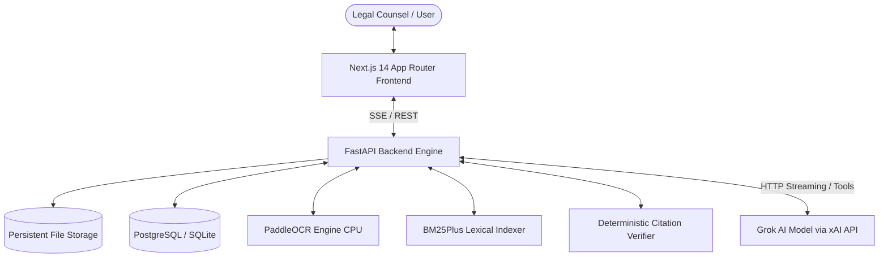
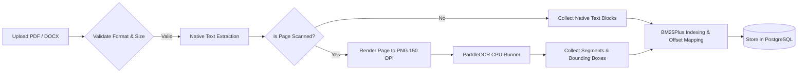
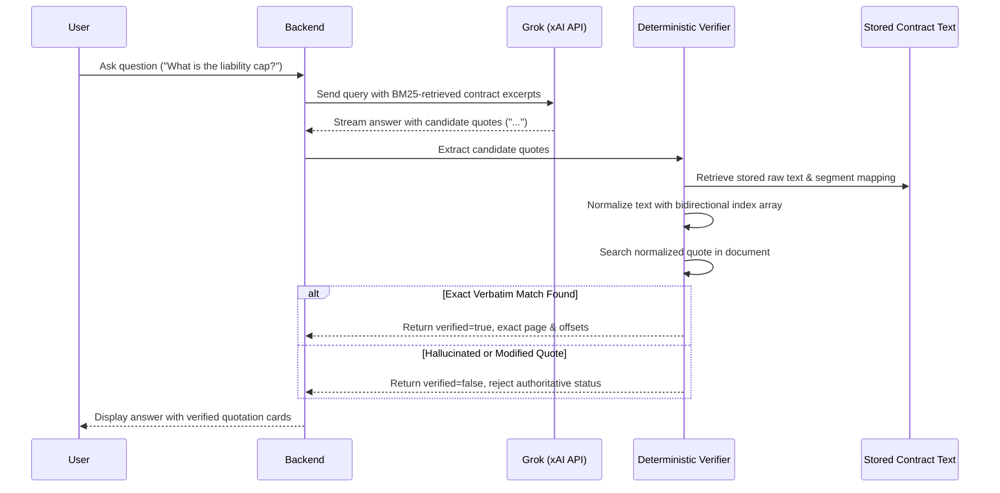

# ClauseWise Architecture & Systems Design

## 1. System Overview

ClauseWise is an enterprise-grade AI legal contract intelligence platform designed to handle complex legal agreements (PDF and DOCX) up to 150+ pages. The system is engineered around **deterministic verification**, ensuring that every quotation surfaced to legal counsel is mathematically and textually validated against stored contract text rather than assumed from model output.



---

## 2. Technology Stack & Component Separation

### Frontend (`frontend/`)
- **Framework:** Next.js 14 (App Router) with React 18 & TypeScript strict mode.
- **Styling:** Tailwind CSS with a restrained legal palette (slate neutrals and deep navy accents).
- **Icons & Components:** Lucide React icons, accessible UI primitives, custom highlight halos.
- **State & Streaming:** Real-time Server-Sent Events (SSE) consumer with `AbortController` cancellation.
- **Document Viewing:** Dual-mode viewer supporting structured text-layer navigation and native PDF preview.

### Backend (`backend/`)
- **Framework:** Python 3.11 with FastAPI and Uvicorn.
- **Database ORM:** SQLAlchemy (AsyncIO) with Alembic migration pipeline.
- **Document Extractors:** PyMuPDF (`fitz`) for digital PDFs; `python-docx` for Word agreements.
- **OCR Engine:** PaddleOCR (CPU-optimized, portrait layout tuned, lazy model loader).
- **Retrieval Engine:** `BM25Plus` lexical index with clause and paragraph chunking.
- **AI Integration:** Official xAI API (`https://api.x.ai/v1`) with streaming SSE and tool calling.

---

## 3. Document Processing & OCR Pipeline



1. **Upload & Sanitization:** Files are validated by MIME type, extension (`.pdf`, `.docx`), and size (< 50MB). Files are assigned unique UUIDs and safe filesystem paths.
2. **Native Parsing:**
   - PDFs are parsed block-by-block using PyMuPDF (`fitz`), capturing character spans, line coordinates, and font metadata.
   - DOCX files are parsed with `python-docx`, maintaining paragraph indices, heading hierarchies, and table cell matrices.
3. **Scanned Page Detection:**
   - Pages with fewer than 50 extracted characters but containing embedded raster images or vector drawing paths are flagged as scanned.
4. **PaddleOCR Fallback:**
   - Scanned pages are rendered to 150 DPI PNG buffers.
   - PaddleOCR processes the image without angle classification (`use_angle_cls=False`), extracting text lines and normalized bounding polygon coordinates `[ymin, xmin, ymax, xmax]`.
5. **Segment Representation:**
   Every paragraph or block is represented as a `DocumentSegment` with start/end character offsets, page number, section title, and bounding box.

---

## 4. Deterministic Quotation Verification Engine

The core design principle of ClauseWise is that **LLM output is never trusted as authoritative legal evidence**.



### Verification Algorithm
1. **Bidirectional Character Mapping:**
   Text extraction introduces whitespace variances (soft hyphens, line breaks, non-breaking spaces, unicode curly quotes `“”`, dashes `—`). The verifier normalizes both the contract and the quote while maintaining an index array `norm_to_orig: List[int]` mapping each normalized character back to its raw document offset.
2. **Normalized Substring Search:**
   Searches for the exact normalized quotation substring in the document text.
3. **Offset Reconstruction:**
   Maps the start and end indices of the match back to exact original character positions `[orig_start, orig_end]`.
4. **Disambiguation:**
   For repeated clauses, the verifier leverages page hints and surrounding paragraph offsets to identify the exact cited occurrence.
5. **Rejection of Hallucinations:**
   If the quote was altered, embellished, or fabricated by the model, it is marked `verified = False` and prevented from appearing as a verified citation.

---

## 5. Contract Version Comparison Engine

ClauseWise compares two contracts (Baseline vs Revised) deterministically before asking AI to explain legal implications:

1. **Clause Grouping & Alignment:**
   Segments are grouped into structural clauses using headings and numbering patterns.
2. **Diff Categorization:**
   - Added: Clause exists in Target but not Base.
   - Removed: Clause exists in Base but not Target.
   - Modified: Clause exists in both but contains textual variations.
3. **Numeric Shift Detection:**
   Extracts currency figures, percentages, caps, and timeframes (e.g. `AED 100,000` -> `AED 1,000,000`, `30 days` -> `60 days`). Any shift in figures within liability, indemnity, or payment clauses is automatically elevated to **Critical** significance.
4. **Legal Significance Scoring:**
   - **Critical:** Liability limits, indemnification, consequential damages, termination rights.
   - **High:** Payment terms, automatic renewals, governing law, warranties.
   - **Medium:** Confidentiality, notices, assignment.
   - **Low:** Boilerplate wording refinements.
5. **AI Substantive Explanation:**
   Grok is prompted specifically on the aligned diff to explain the legal effect in plain language, with dual verified citations to both baseline and revised versions.

---

## 6. Part C Option 2: Autonomous Agentic Research

Instead of linear prompt injection, Option 2 equips Grok with tools to conduct autonomous contract investigation:

```mermaid
flowchart TD
    Start[User Submits Complex Legal Inquiry] --> Round1[Round 1: Grok Evaluates Objective]
    Round1 --> Decide{Model Action}
    Decide -- Model Calls Tool --> ToolExec[Backend Executes Tool against Index]
    ToolExec --> Tools[Available Tools:<br/>1. search_document(query)<br/>2. get_section(name)<br/>3. list_clauses()<br/>4. get_document_overview()]
    Tools --> ReturnRes[Tool Result Fed Back to Model]
    ReturnRes --> NextRound{Next Round <= 6?}
    NextRound -- Yes --> Decide
    NextRound -- Cap Reached --> Finalize[Force Synthesis & Verification]
    Decide -- Model Generates Text --> Finalize
    Finalize --> VerifyQuotes[Deterministic Citation Verification]
    VerifyQuotes --> UIStream[Stream Final Synthesized Answer to Counsel]
```

### Safety & Guardrails
- **Hard Round Cap:** Maximum of 6 execution rounds prevents runaway tool loops and unbounded cost.
- **Malformed Call Resilience:** Invalid arguments or unknown function calls return structured error payloads back to the model without crashing the request.
- **Live Activity Streaming:** Every tool call, parsed arguments, and execution summary stream to the UI in real time via Server-Sent Events.

---

## 7. Render Production Deployment Architecture

ClauseWise deploys as two decoupled services with managed database and durable disk:

1. **FastAPI Web Service (`clausewise-backend`):**
   - Packaged in a lightweight Debian-based container with Python 3.11, PyMuPDF, OpenCV, and PaddleOCR dependencies.
   - Bound to `0.0.0.0:$PORT`.
   - Connected to a Render Persistent Disk (`/app/uploads`, 10GB) for persistent contract storage.
   - Automated Alembic migrations on startup.
2. **Next.js Web Service (`clausewise-frontend`):**
   - Node.js runtime building with `npm run build`.
   - Reads backend URL from `NEXT_PUBLIC_BACKEND_URL`.
   - Zero exposure of Grok API keys or database credentials to the browser.
3. **Render Managed PostgreSQL (`clausewise-db`):**
   - High-performance ACID storage for contract metadata, segment offsets, conversations, comparisons, and agent run histories.
