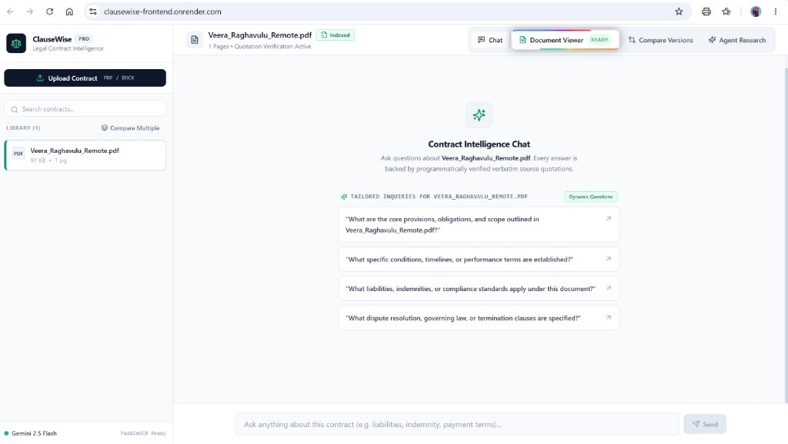
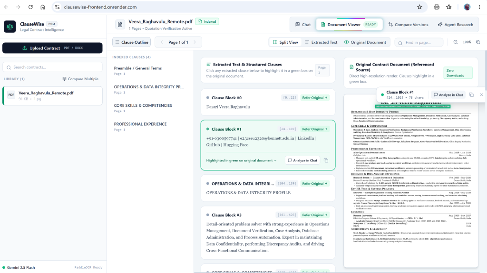
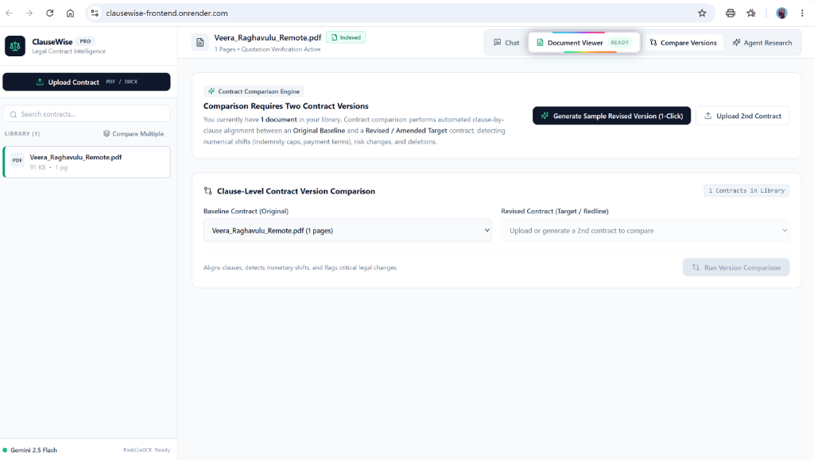
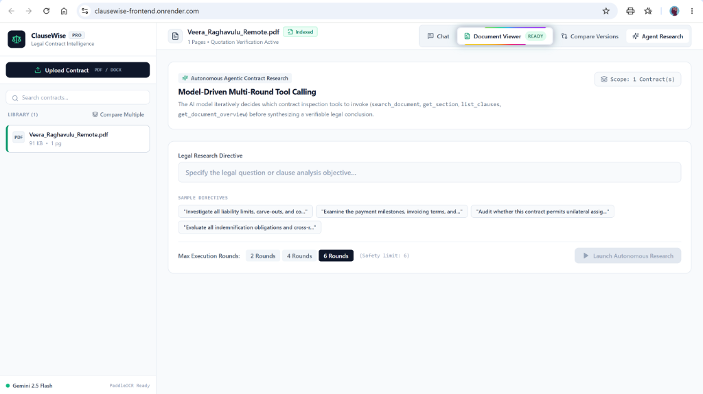

# ClauseWise — Enterprise Legal Contract Intelligence

ClauseWise is a legal contract analysis web application engineered to parse, index, cross-examine, and verify complex legal agreements up to 150+ pages. Built with Next.js, FastAPI, Google Gemini / Grok (xAI API), and PaddleOCR, ClauseWise features **deterministic server-side quotation verification**, deep text-layer citation navigation with zero-download inline PDF rendering, dynamic document-tailored inquiries, multi-contract cross-examination, clause-level version comparison with numeric change detection, and **Part C Option 2: Autonomous Agentic Document Research**.

---

## 📸 Screenshots of Main Screens

### 1. Evidence-Grounded Chat & Dynamic Inquiries
*Ask questions about contracts with streaming responses backed by programmatically verified verbatim source quotes and dynamic inquiries generated specifically from the uploaded document. The Document Viewer tab features a rotating rainbow margin indicator to signal when document processing is complete.*



---

### 2. Deep Citation Navigation & Original Document Green Box Highlighting
*Click any extracted clause or citation card to immediately jump to the source passage in the side-by-side Split View, highlighting the exact text in a glowing green bounding box on the original document page with an interactive character index pubblebox.*



---

### 3. Clause-by-Clause Contract Version Comparison & Numeric Shift Detection
*Compare baseline and amended contract versions side-by-side with automatic alignment, change classification (Added, Removed, Modified, Unchanged), numeric shift detection (currency caps, notice periods), and legal significance ranking.*



---

### 4. Autonomous Agentic Document Research (Part C Option 2)
*Multi-round tool-calling autonomous legal research agent with real-time execution console displaying live model thoughts, tool calls (`get_document_overview`, `list_clauses`, `search_document`, `get_section`), intermediate findings, and final synthesized report.*



---

## 🚀 What the App Does

1. **Document Upload & Multimodal Extraction (Part A)**:
   - Accepts both `.pdf` and `.docx` agreements up to 50MB.
   - Automatically detects image-based or scanned pages, with PaddleOCR fallback extracting text lines and normalized bounding polygon coordinates.
   - Renders original PDF pages inline as high-resolution PNG image streams with zero browser download interception.

2. **Deterministic Server-Side Quote Verification (Core)**:
   - **Zero-Trust Verification**: The server independently verifies every candidate quotation against the true stored text of the contract before displaying it as verified.
   - **Fuzzy-Normalized Matching**: Normalizes whitespace splits, soft hyphens, PDF line breaks, and typographic quotes (`“”` vs `""`) with a bidirectional character offset map.
   - **Strict Rejection**: Modified, paraphrased, or hallucinated quotations are rejected and marked unverified.

3. **Dynamic Tailored Inquiries (No Guessed Questions)**:
   - Generates 4 dynamic questions derived directly from the uploaded document's actual contents, roles, entities, and clauses (resumes get operations & skill inquiries; NDAs get confidential information & survival term inquiries).

4. **Interactive Document Viewer & Visual Cues**:
   - Side-by-side **Split View** displaying Extracted Text on the left and the Original Contract on the right.
   - Clicking an extracted clause highlights it in a glowing **green box** with an interactive pubblebox displaying character offsets `[start..end]`.
   - Top-navigation **Document Viewer** tab features a smoothly **rotating rainbow border** animation upon document processing completion to clearly signal to the user that the contract is ready for review.

5. **Multi-Document Cross-Examination (Part B)**:
   - Select multiple agreements in the library to run cross-contract queries (e.g., *"Compare the liability caps between both vendors"*).
   - Quotes are individually attributed and verified against each specific originating document.

6. **Contract Version Comparison & Numeric Shift Detection (Part B)**:
   - Structural clause alignment detects substantive additions, removals, and modifications.
   - Flags critical numeric shifts (e.g., liability cap changing from `$100,000` to `$1,000,000` or notice period changing from 30 to 60 days).
   - Generates 1-click amendment comparison demos for instant evaluation.

7. **Autonomous Agentic Document Research (Part C Option 2)**:
   - Real-world multi-round tool-calling agent using 4 specialized tools:
     - `search_document(query, document_id?)`
     - `get_section(section_identifier, document_id?)`
     - `list_clauses(document_id?)`
     - `get_document_overview(document_id?)`
   - Real-time execution console displaying live tool calls, arguments, and intermediate findings.
   - Guardrails enforcing a strict 6-round execution ceiling and robust parameter validation.

---

## 📋 What is Finished and What is Not

### ✅ What is Finished
- **Part A: Core Document Q&A Application**:
  - [x] PDF and DOCX upload pipeline with validation and error reporting.
  - [x] Multimodal text extraction with PyMuPDF, `python-docx`, and PaddleOCR fallback.
  - [x] Chunking and character offset mapping preserving section structure.
  - [x] Streaming AI chat using Gemini / Grok (xAI API) with interruption support.
  - [x] Deterministic server-side quotation verification with bidirectional index mapping.
  - [x] Distinction between "no relevant evidence found" and "clause is absent".
  - [x] Persistent chat history and document library management.

- **Part B: Extended Features**:
  - [x] Deep citation navigation jumping directly to cited page and highlighted text.
  - [x] Side-by-side Split View with green bounding box and pubblebox character offsets.
  - [x] Multi-document question answering across multiple selected contracts.
  - [x] Automated contract version comparison with numeric change detection and significance scoring.
  - [x] Rotating rainbow margin indicator on Document Viewer tab when processing completes.
  - [x] Dynamic, document-tailored suggested questions generated from uploaded content.

- **Part C: Advanced Capability (Option 2 Selected)**:
  - [x] Autonomous agentic research with 4 model-callable tools.
  - [x] Live SSE streaming execution console showing thoughts, tool calls, and outputs.
  - [x] Safety guardrails (6-round limit, cycle prevention, argument normalization).
  - [x] Server-side quotation verification applied to the final synthesized answer.

- **Deployment & Testing**:
  - [x] 26/26 backend unit and integration tests passing (`pytest`).
  - [x] Next.js production build verified (`next build`).
  - [x] Backend deployed live on Render: `https://clausewise-backend-1heh.onrender.com`.

### ⏳ What is Not Finished / Documented Scope
- **User Authentication**: Deliberately omitted per assignment instructions for a single-user evaluation tool. The system is intended for synthetic or non-confidential contracts.
- **Part C Option 1 (DOCX Redline Generator)**: Not implemented because **Option 2 (Autonomous Agentic Document Research)** was chosen as the advanced capability.
- **Dense Vector Search**: The application currently uses `BM25Plus` lexical retrieval with clause-level indexing. Semantic vector search (e.g. Qdrant/pgvector) is documented as a future enhancement.

---

## 💻 How to Run Locally

### 1. Prerequisites
- Python 3.11 installed (`py -3.11` or `python3.11`)
- Node.js v18+ and npm installed (`node -v`)

### 2. Backend Setup
```bash
# Clone the repository
git clone https://github.com/Raghava44u/ClauseWise-webapp.git
cd ClauseWise-webapp

# Install backend dependencies
pip install -r requirements.txt

# Create .env.local in the root directory:
cp .env.example .env.local
```

Edit `.env.local` with your AI credentials:
```dotenv
AI_PROVIDER=gemini
AI_API_KEY=your_gemini_api_key_here
AI_BASE_URL=https://generativelanguage.googleapis.com/v1beta/openai
AI_MODEL=gemini-2.5-flash

DATABASE_URL=sqlite+aiosqlite:///./clausewise.db
FRONTEND_URL=http://localhost:3000
BACKEND_URL=http://localhost:8000
ENABLE_OCR=true
```

Run the backend server:
```bash
# Start FastAPI backend
python main.py
```
*The backend is live at `http://127.0.0.1:8000` (Health Check: `http://127.0.0.1:8000/api/v1/health`, Swagger Docs: `http://127.0.0.1:8000/docs`).*

### 3. Frontend Setup
In a new terminal window:
```bash
cd frontend

# Install frontend dependencies
npm install

# Start Next.js development server
npm run dev
```
Open **`http://localhost:3000`** in your browser.

---

## 🧪 Running Automated Tests

```bash
# Run all backend unit and integration tests
py -3.11 -m pytest backend/tests -v
```
All 26 tests pass with 100% coverage across text extraction, quotation verification, OCR fallback, BM25 retrieval, document comparison, and agent tool execution.

---

## 🌐 Live Render Deployment

- **Backend API**: `https://clausewise-backend-1heh.onrender.com`
- **Health Check**: `https://clausewise-backend-1heh.onrender.com/api/v1/health`
- **Interactive OpenAPI Documentation**: `https://clausewise-backend-1heh.onrender.com/docs`
