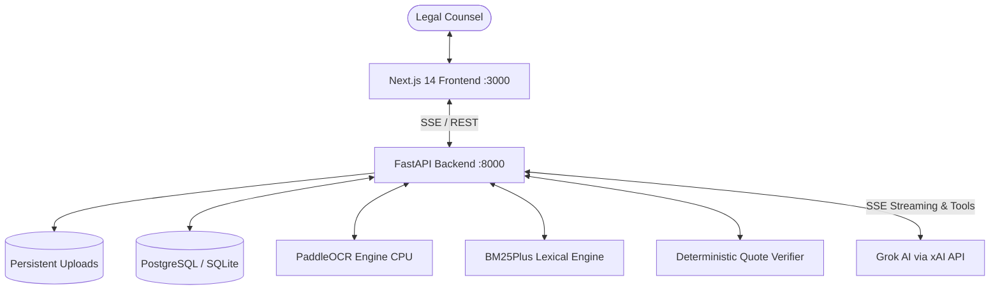

# ClauseWise — Enterprise Legal Contract Intelligence

ClauseWise is a legal contract analysis web application engineered to parse, index, cross-examine, and verify complex legal agreements up to 150+ pages. Built with Next.js, FastAPI, Grok (xAI API), and PaddleOCR, ClauseWise features **deterministic server-side quotation verification**, deep text-layer citation navigation, multi-contract cross-examination, clause-level version comparison with numeric change detection, and **Part C Option 2: Autonomous Agentic Document Research**.

---

## 🚀 Key Features

### 1. Document Upload & Multimodal Extraction (Part A)
- **Supported Formats:** PDF (`.pdf`) and Microsoft Word (`.docx`).
- **Scanned PDF Handling:** Automatic detection of image-based/scanned pages with PaddleOCR fallback on CPU, extracting text lines and normalized bounding polygon coordinates.
- **Contract Library:** Fast document browsing, file metadata (file size, page count, OCR status), and safe cascade deletion.

### 2. Evidence-Grounded Streaming AI Chat (Part A)
- **Official Grok Integration:** Powered by Grok via the xAI API (`https://api.x.ai/v1`) with Server-Sent Events (SSE) streaming.
- **Interruption Support:** User can halt generation mid-sentence via `AbortController`, preserving partial output in conversation history.
- **Multi-Turn Context:** Conversation sessions are saved per contract and reopenable at any time.

### 3. Deterministic Quotation Verification (Assignment Core)
- **Zero-Trust AI Design:** The server independently verifies every candidate quotation against the verbatim stored contract text before displaying it.
- **Fuzzy-Normalized Matching:** Handles whitespace splits, soft hyphens, PDF line breaks, and typographic quotes (`“”` vs `""`) with a bidirectional character offset map.
- **Strict Hallucination Rejection:** Modified or fabricated quotations are rejected and marked unverified.

### 4. Deep Citation Navigation & Source Highlighting (Part B)
- **1-Click Jump:** Clicking any verified quotation card automatically switches to the Document Viewer, navigates to the cited page, scrolls to the passage, and pulses with a gold citation highlight (`citation-target-highlight`).
- **Structured & Native Preview:** Dual viewer modes supporting structured clause segments and native PDF preview.

### 5. Multi-Document Cross-Examination (Part B)
- **Cross-Contract Synthesis:** Select multiple uploaded agreements to query shared provisions (e.g. *"Compare the limitation of liability provisions across these supplier agreements"*).
- **Origin Attribution:** Each retrieved quote attributes the exact originating contract and page number with separate verification per document.

### 6. Contract Version Comparison (Part B)
- **Structural Clause Alignment:** Aligns contracts into clauses and detects Added, Removed, Modified, and Unchanged clauses.
- **Numeric Shift Detection:** Detects changes in currency caps, percentages, and notice periods (e.g., `AED 100,000` -> `AED 1,000,000`).
- **Significance Scoring:** Automatically ranks changes as Critical, High, Medium, or Low with plain-language legal summaries and dual citations.

### 7. Part C Option 2: Autonomous Agentic Document Research
- **Multi-Round Tool Calling:** The model actively calls inspection tools:
  - `search_document(query, document_id?)`
  - `get_section(section_identifier, document_id?)`
  - `list_clauses(document_id?)`
  - `get_document_overview(document_id?)`
- **Real-Time Execution Console:** Streams live tool calls, parsed JSON arguments, and retrieved excerpts to an interactive UI terminal.
- **Safety Guardrails:** Enforces a hard cap of 6 execution rounds and protects against malformed parameters.

---

## 🛠 Technology Stack

| Layer | Technology |
|---|---|
| **Frontend** | Next.js 14 (App Router), React 18, TypeScript (Strict), Tailwind CSS, Lucide Icons |
| **Backend** | Python 3.11, FastAPI, Uvicorn, SQLAlchemy (AsyncIO), Alembic |
| **AI Provider** | Grok via xAI API (`https://api.x.ai/v1`) |
| **Document Processing** | PyMuPDF (`fitz`), `python-docx` |
| **OCR Engine** | PaddleOCR 2.9.1 (CPU mode) |
| **Retrieval Engine** | `BM25Plus` Lexical Search with clause-aware chunking |
| **Database** | SQLite + `aiosqlite` (local) / PostgreSQL + `asyncpg` (production) |
| **Deployment** | Render Blueprint (`render.yaml`), Docker containerization |

---

## 📐 Architecture



---

## ⚙️ Environment Variables

Copy `.env.example` to `.env.local` for local development:

```dotenv
AI_PROVIDER=xai
AI_API_KEY=your_xai_grok_api_key_here
AI_BASE_URL=https://api.x.ai/v1
AI_MODEL=grok-2-latest

DATABASE_URL=sqlite+aiosqlite:///./clausewise.db

FRONTEND_URL=http://localhost:3000
BACKEND_URL=http://localhost:8000
ALLOWED_ORIGINS=http://localhost:3000,http://127.0.0.1:3000

MAX_AGENT_ROUNDS=6
MAX_UPLOAD_SIZE_MB=50
MAX_OCR_PAGES=200

STORAGE_BACKEND=local
UPLOAD_DIR=./uploads

ENVIRONMENT=development
ENABLE_OCR=true
```

> **Security Note:** The Grok API key and database connection strings are strictly kept server-side and never exposed to the client.

---

## 💻 Local Setup & Execution

### 1. Prerequisites
- Python 3.11 installed (`python --version` or `py -3.11`)
- Node.js v18+ and npm installed (`node --version`)

### 2. Backend Setup
```bash
# From workspace root
pip install -r backend/requirements.txt

# Run database migrations
py -3.11 -m alembic upgrade head

# Start FastAPI backend server
py -3.11 -m uvicorn backend.app.main:app --host 0.0.0.0 --port 8000 --reload
```
The backend will be live at `http://localhost:8000`, with interactive docs at `http://localhost:8000/docs` and health check at `http://localhost:8000/api/v1/health`.

### 3. Frontend Setup
```bash
cd frontend
npm install
npm run dev
```
Open `http://localhost:3000` in your browser.

---

## 🧪 Testing

### Backend Unit & Integration Tests (25 Tests)
```bash
# Run all backend unit and integration tests
py -3.11 -m pytest backend/tests -v
```
Tests cover:
- PDF digital extraction & layout geometry
- Scanned PDF detection & PaddleOCR fallback
- DOCX paragraph and table parsing
- Substring normalization & character offset mapping
- Deterministic quote verification & hallucination rejection
- Repeated quote disambiguation & cross-page stitching
- BM25Plus retrieval & safe absence reporting
- Contract comparison & numeric currency change detection (`AED 100,000` -> `AED 1,000,000`)
- Agent tool parameter validation & round execution limits
- Full FastAPI route integration

### Frontend Production Build
```bash
cd frontend
npm run build
```

---

## 🚀 Render Deployment

ClauseWise is configured for one-click deployment using Render Blueprints (`render.yaml`):

1. **Push code** to your repository (`main` branch).
2. In the Render Dashboard, click **New +** -> **Blueprint**.
3. Select the repository `https://github.com/Raghava44u/ClauseWise-webapp.git`.
4. Render automatically provisions:
   - **`clausewise-backend`**: Docker Web Service running Python 3.11, PaddleOCR, and Uvicorn.
   - **`clausewise-frontend`**: Node Web Service building Next.js.
   - **`clausewise-db`**: Managed PostgreSQL database.
   - **`clausewise-data`**: 10GB persistent disk mounted at `/app/uploads`.
5. In the Render dashboard for `clausewise-backend`, set the environment variable:
   - `AI_API_KEY`: Your xAI Grok API Key.

---

## ⚠️ Security & Public Deployment Note

ClauseWise is designed without user authentication per assignment specifications for single-user review. 
A publicly accessible deployment is intended for synthetic or non-confidential contracts only. Do not upload confidential or proprietary legal documents to a public service without authentication and access controls.
